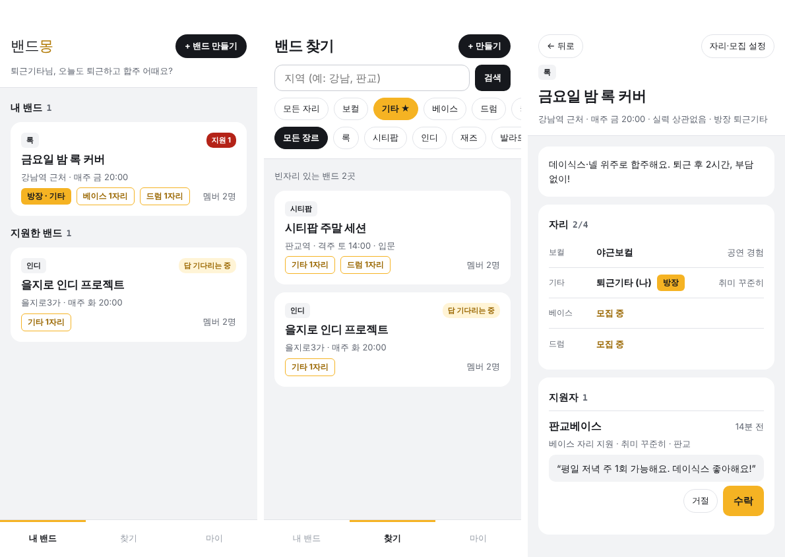
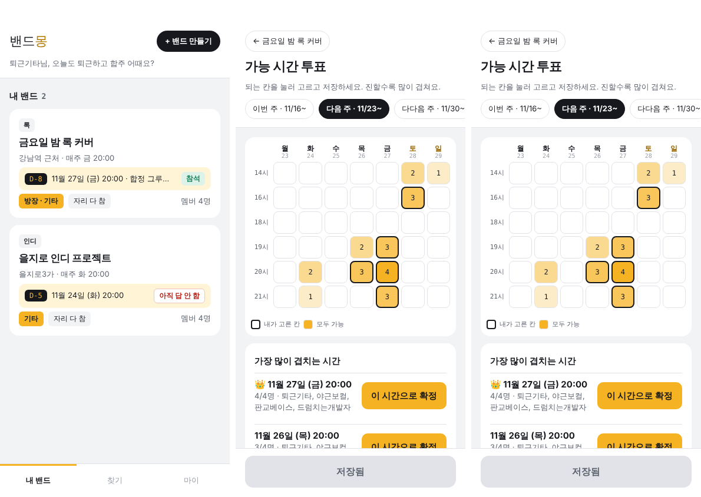
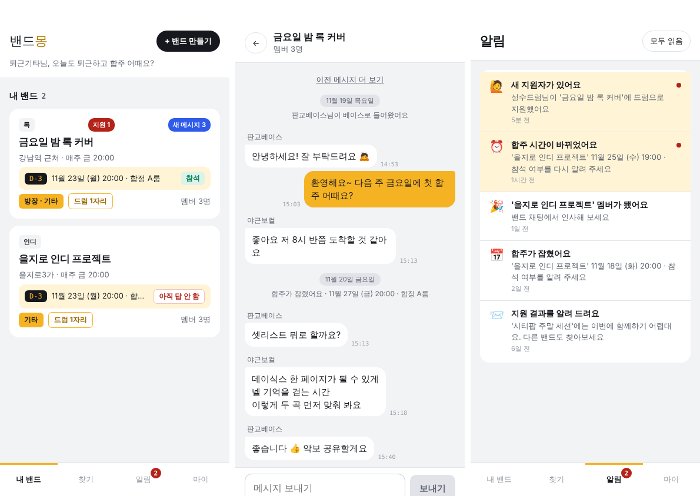
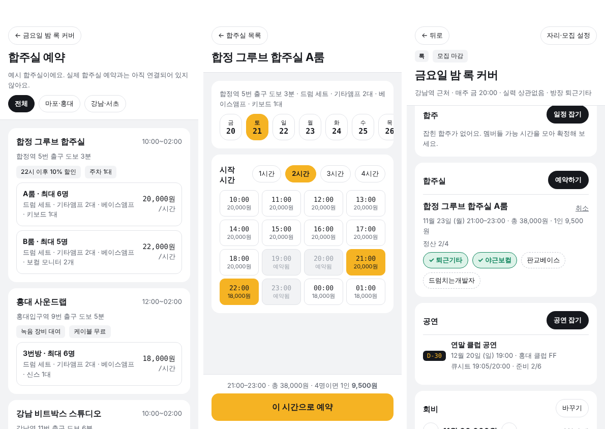
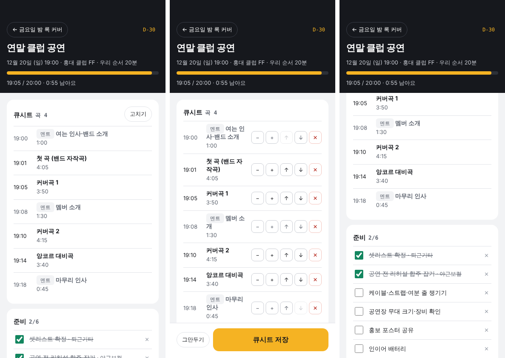
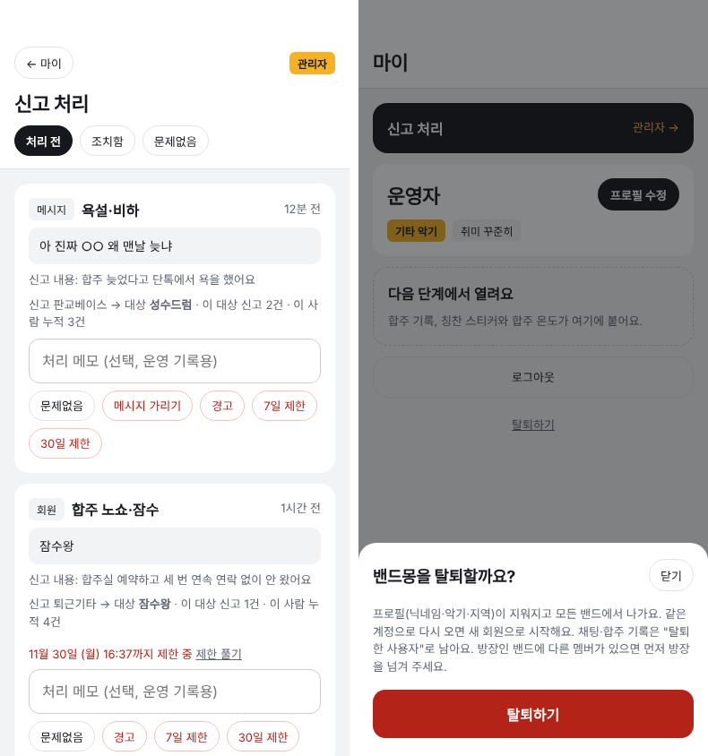
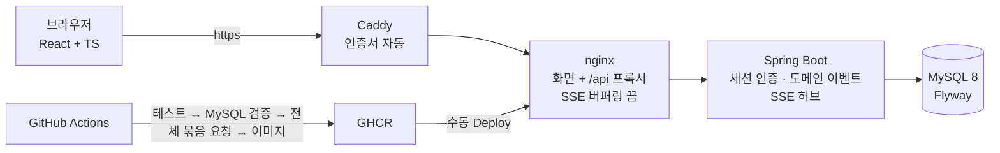

# 밴드몽 🎸

[](https://github.com/y2k8861/bandmong/actions/workflows/ci.yml)

**퇴근한 직장인이 회사 근처에서 같이 합주할 사람을 찾고, 합주 일정·합주실·회비·공연 준비까지 한곳에서 꾸리는 모바일 웹 서비스.**

HTML 한 파일짜리 프로토타입을 **Spring Boot + React** 서비스 구조로 다시 만든 1인 개인 프로젝트입니다 (2026년 10월 ~ 11월).
단계마다 무엇을 왜 그렇게 만들었는지 [`docs/`](docs/)에 기록했습니다.

| REST API | MySQL 테이블 | 자동 테스트 | push마다 CI 검사 |
| :---: | :---: | :---: | :---: |
| 55 | 22 | 76 (백 48 · 프론트 28) | 5 |



## 무엇을 하나

| 직장인 밴드의 고민 | 밴드몽에서 |
| --- | --- |
| "베이스 한 명만 더 있으면 되는데" | 악기별 빈자리로 밴드 찾기 → 지원 → 방장 수락 |
| "다들 언제 돼요?" | 주간 가능 시간 투표 → 가장 많이 겹치는 시간 추천 → 합주 확정 → 참석 응답 |
| "합주실 누가 잡았어요? 얼마 보내면 돼요?" | 합주실 시간표 예약 → 1인 몫 자동 계산 → 정산·월 회비 표시 |
| "공연 20분인데 곡이 넘쳐요" | 큐시트(곡·멘트별 시작 시각, 시간 초과 표시) + 준비 체크리스트 |
| 단톡방에 묻히는 소식 | 밴드 채팅·알림 (실시간), 신고·운영 |

<details>
<summary><b>화면 더 보기</b> (개발용 예시 데이터)</summary>

| 가능 시간 투표 → 합주 확정 | 채팅·알림 |
| --- | --- |
|  |  |
| **합주실 예약·1인 정산** | **공연 큐시트·준비 목록** |
|  |  |
| **신고 처리(관리자)·탈퇴** | |
|  | |

합주실 7곳은 예시 데이터이며 실제 합주실 예약과는 연결되어 있지 않습니다.
</details>

## 기술적으로 고민한 점

- **동시 수정을 상황마다 다르게 막았습니다** — [자세히](docs/stage-05.md)
  - 마지막 빈자리에 동시 수락 → 밴드 행 **비관적 잠금** (`SELECT … FOR UPDATE`)
  - 두 밴드가 같은 방·같은 시간 예약 → 시간 칸 **유니크 키** (`room_slots(room_id, slot_start)`)
  - 두 멤버가 같은 큐시트 저장 → **낙관적 잠금** (`@Version` + 내가 본 버전), 충돌 시 "최신으로 불러오기"
  - 세 경우 모두 두 스레드로 동시에 요청하는 테스트로 "한 명만 성공"을 확인
- **실시간은 WebSocket 대신 SSE, DB 커밋 뒤에만 전송** — 세션 로그인을 그대로 쓰고, 롤백된 "없는 메시지"가 화면에 남지 않게 ([자세히](docs/stage-04.md))
- **도메인 이벤트로 알림 분리** — 밴드·합주 코드는 "일어난 일"만 발행하고, 알림·채팅 안내는 리스너 한 곳에서 결정
- **채팅** — OFFSET 대신 id 커서 페이지, 멤버별 읽음 위치 하나로 안 읽은 수 계산, `clientId`로 재전송 중복 방지
- **시간** — UTC로 저장하고 "이번 주"·요일은 한국 시간으로 판단, `Clock` 주입으로 시간 경과 테스트 ([자세히](docs/stage-03.md))
- **세션 + CSRF 쿠키** (JWT 대신) — 웹앱 하나만 쓰는 서비스, 토큰을 브라우저 저장소에 두지 않음 ([자세히](docs/stage-01.md))
- **iOS 앱은 같은 서버에 Bearer 토큰으로** — 앱은 출처가 달라 쿠키가 막히므로 해시로 저장하는 앱 토큰 + 1회용 코드로 소셜 로그인 복귀, 웹 흐름은 그대로 ([자세히](docs/stage-07.md))
- **운영 DB는 Flyway만 바꾸고 `validate`** — CI가 push마다 실제 MySQL 8.4에 운영 설정 그대로 붙여 검증 ([자세히](docs/stage-06.md))

## 구조



## 트러블슈팅

| 증상 | 원인 | 해결 |
| --- | --- | --- |
| 회비 조회만 SQL 문법 오류 | 컬럼 이름 `month`가 H2 예약어 | `due_month`로 변경, CI에 실제 MySQL 검증 작업 추가 |
| 테스트에서만 한글이 깨짐 | charset 없는 응답을 MockMvc가 ISO-8859-1로 읽음 | 테스트 도우미가 UTF-8로 읽도록 수정 |
| 밴드 테스트가 전부 400 | 테스트 로그인 이름(36자)이 서버 규칙(20자) 초과, 실패 본문이 로그에 없음 | 기대와 다른 상태 코드면 응답 본문을 실패 메시지에 담는 도우미 추가 |
| (설계 단계) 가능 시간 재저장 시 중복 키 | Hibernate가 INSERT를 DELETE보다 먼저 실행 | "전부 지우고 다시 넣기" 대신 빠진 칸만 삭제·새 칸만 추가 |

## 기술 스택

| 영역 | 사용 기술 |
| --- | --- |
| 백엔드 | Java 21, Spring Boot 3.3, Spring Security(세션 + CSRF 쿠키, OAuth2 로그인), Spring Data JPA |
| DB | 로컬 H2(메모리) / 운영 MySQL |
| 프론트 | React 18, TypeScript, Vite, React Router |
| 테스트 | JUnit 5 + MockMvc, Vitest + Testing Library |
| 실시간 | SSE(Server-Sent Events) — 채팅·알림 |
| DB 마이그레이션 | Flyway (운영 MySQL은 `ddl-auto: validate`) |
| 배포 | Docker, nginx, Caddy(https), GHCR, AWS EC2 + RDS |
| 앱 | Capacitor 7 (iOS), Apple로 로그인, Firebase Cloud Messaging 푸시 |
| CI/CD | GitHub Actions: 테스트 → MySQL 검증 → 전체 묶음 스모크 테스트 → 이미지 푸시 → (수동) EC2 배포 |

## 폴더 구조

```
bandmong/
├── backend/    Spring Boot API 서버 (포트 8080)
├── frontend/   React 앱 (개발 서버 5173, /api는 8080으로 프록시)
│   └── ios/    Capacitor iOS 프로젝트
└── docs/       단계별 설계 기록
```

## 로컬에서 실행하기

필요한 것: JDK 21, Node 22

```bash
# 1) 백엔드 — dev 프로필(H2 메모리 DB, 개발용 로그인)으로 뜬다
cd backend
./gradlew bootRun

# 2) 프론트 — 다른 터미널에서
cd frontend
npm install
npm run dev
```

브라우저에서 http://localhost:5173 을 열고 **개발용 로그인**에 아무 이름이나 넣으면 됩니다.
같은 이름으로 다시 들어오면 같은 계정이에요.

테스트: `cd backend && ./gradlew test`, `cd frontend && npm test`

### 운영과 같은 구성으로 한 번에 띄우기 (Docker)

```bash
docker compose up --build      # MySQL + Spring + nginx → http://localhost:8000
deploy/smoke-test.sh           # 로그인·한글·실시간 연결까지 자동 확인
```

## 배포

AWS EC2 + RDS(MySQL) + Docker + GitHub Actions 구성으로 준비되어 있다. → [배포 가이드](docs/deploy.md)

- push마다 CI가 ① 백엔드·프론트 테스트 ② **실제 MySQL**에 운영 설정으로 붙여 마이그레이션 검증
  ③ docker compose로 전체를 띄워 실제 요청 확인 ④ 이미지를 GHCR에 푸시
- 배포는 Actions의 Deploy를 손으로 실행 (이미지 태그로 되돌리기 가능)
- iOS 앱은 Actions의 **iOS TestFlight**를 손으로 실행 (맥 없이 빌드·서명·업로드) → [iOS 출시 가이드](docs/ios-release.md)

## 진행 상황

- [x] **1단계** 프로젝트 뼈대, 로그인(개발용 + 카카오·네이버·구글 준비), 프로필 설정 — [설계 기록](docs/stage-01.md)
- [x] **2단계** 밴드 만들기·찾기·지원, 방장 수락/거절, 마지막 자리 동시 수락 방지 — [설계 기록](docs/stage-02.md)
- [x] **3단계** 가능 시간 투표, 합주 확정·변경·취소, 참석 응답 — [설계 기록](docs/stage-03.md)
- [x] **4단계** 밴드 채팅, 알림, 실시간 연결(SSE) — [설계 기록](docs/stage-04.md)
- [x] **5단계** 합주실 예약·1인 정산·월 회비, 공연 큐시트·체크리스트 — [설계 기록](docs/stage-05.md)
- [x] **6단계** 신고·관리자 처리·이용 제한, 방장 넘기기·탈퇴, 배포 준비(Flyway·Docker·CI/CD·AWS 가이드) — [설계 기록](docs/stage-06.md)
- [x] **7단계** iOS 앱(Capacitor), Apple 로그인, 푸시 알림, 욕설 필터·차단, TestFlight 자동 업로드 — [설계 기록](docs/stage-07.md)
